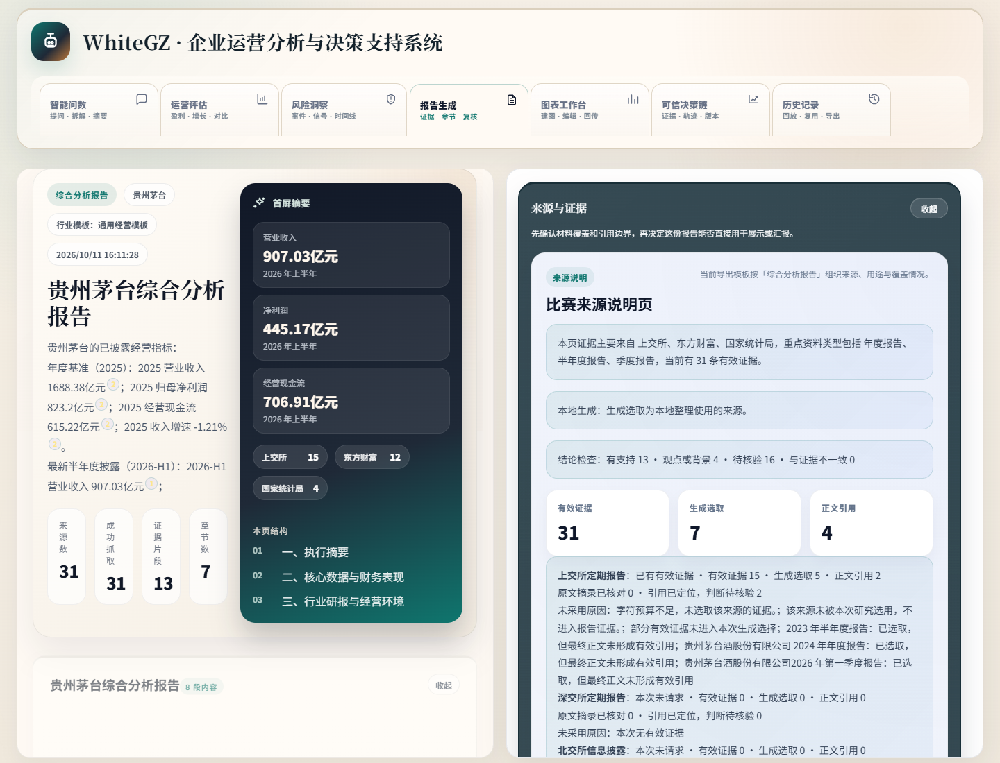
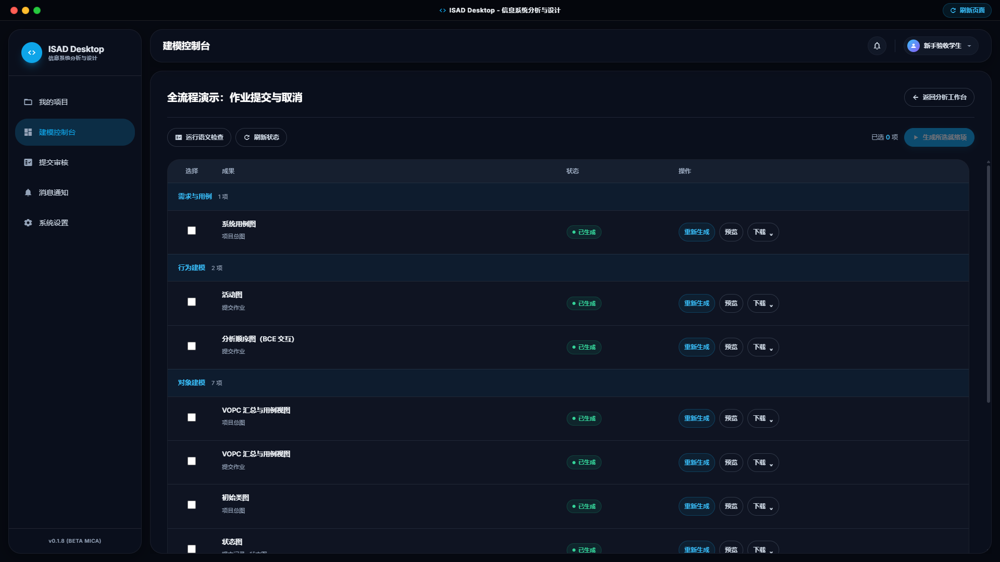
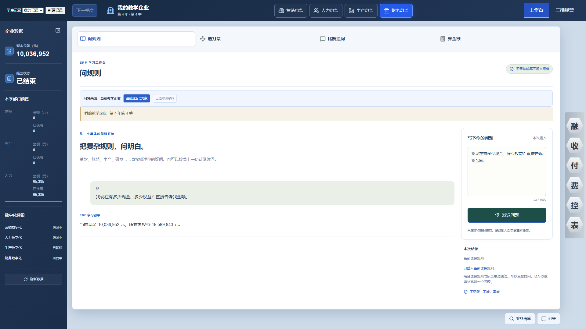

# Whitegg · 项目作品集

从企业研究、教学建模到经营模拟，把 AI 能力接入有依据、可编辑、可验证的业务流程。

[截图与演示](docs/demo-guide.md) · [运行与构建](docs/deployment.md) · [核验记录](docs/verification.md) · [维护记录](CHANGELOG.md)

第一次来：先选一个项目，看「问题与实现」和架构图，再沿截图查看实际产物。项目页包含技术取舍和验证边界。

## 精选项目

| [WhiteGZ](projects/whitegz.md) | [ISAD](projects/isad.md) | [ERP Agent](projects/erp-agent.md) |
| --- | --- | --- |
|  |  |  |
| **证据追踪与报告资产** | **分析版本与建模产物一致性** | **确定性执行与候选回放** |
| Node.js / Express · 共享数据契约 | Electron / React / MySQL · StarUML | Python / FastAPI · PostgreSQL / Qdrant |
| 历史公开来源样本，数字未重新核验 | 隔离 QA 教学示例，无真实学生数据 | 学生助手独立演示，资金均为模拟值 |
| [3 张界面](projects/whitegz.md#界面与成果) · [运行说明](docs/deployment/whitegz.md) | [4 张界面与产物](projects/isad.md#界面与成果) · [构建说明](docs/deployment/isad.md) | [2 张助手界面](projects/erp-agent.md#界面与成果) · [运行说明](docs/deployment/erp-agent.md) |

点击预览进入技术案例。WhiteGZ 展示结论核验和图表编辑；ISAD 展示建模与实际顺序图；ERP 图片展示独立学生助手，主工程的规则与规划另作说明。

## 更多项目

- [拾光盒子 CampusLoop](projects/campusloop.md)：校园闲置流转与迎新物资服务 MVP，含 3 张业务界面与本地运行说明。
- [DNUI · 党员成长积分管理系统](projects/dnui.md)：学生申报、教师审核与管理业务。真实校园截图和数据不在公开范围。

## 按你关心的内容阅读

- **看产品流程**：[演示导览](docs/demo-guide.md)，按问题、操作和可见产物阅读 4 个项目。
- **看技术结构**：三个精选项目页中的架构图与实现取舍；[状态总览](docs/project-status.md)集中列出技术栈与待验证项。
- **准备本地运行**：[运行与部署](docs/deployment.md)，先确认已取得相应私有源码授权。
- **了解持续维护**：[更新记录](CHANGELOG.md)、[自动检查](docs/maintenance.md#自动检查)与[核验记录](docs/verification.md)。

## 公开边界

这是**展示仓库**，不是产品源码仓库。克隆后可阅读文档和图片，不能启动各产品；运行教程面向已获得源码授权的协作者。目前没有公共在线体验地址、软件安装包或已审核的完整演示视频。

产品源码、真实数据与原始内部记录保持私有。截图来自既有工程演示或隔离验证资料，每张图片的说明与文件指纹可查。

[素材说明](assets/README.md) · [公开范围](docs/publication-policy.md)
