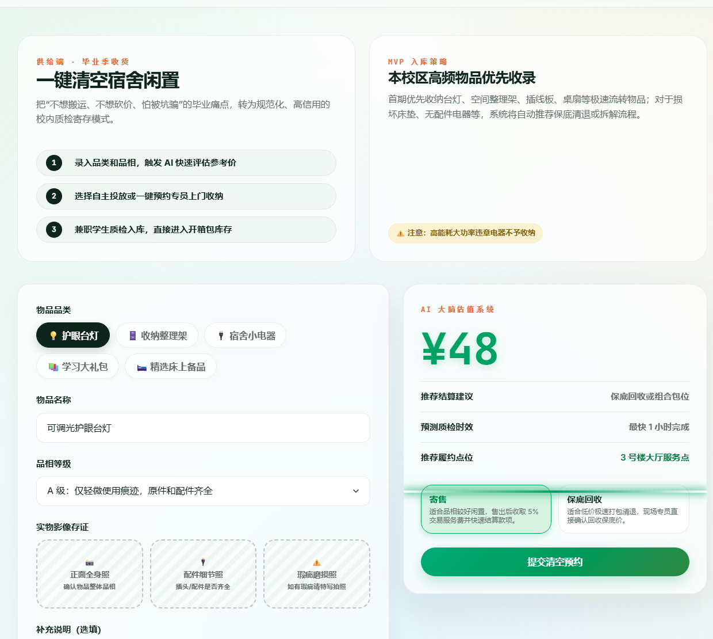
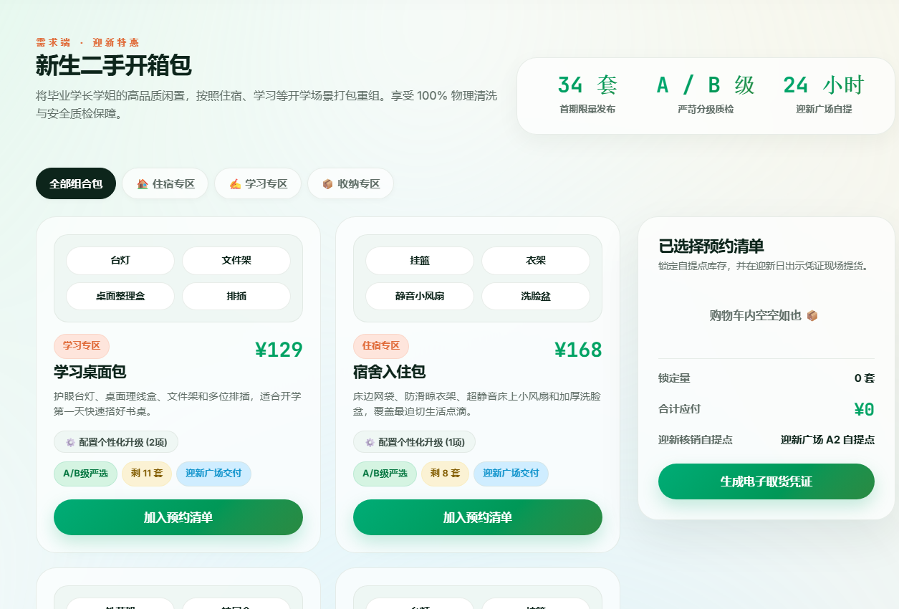
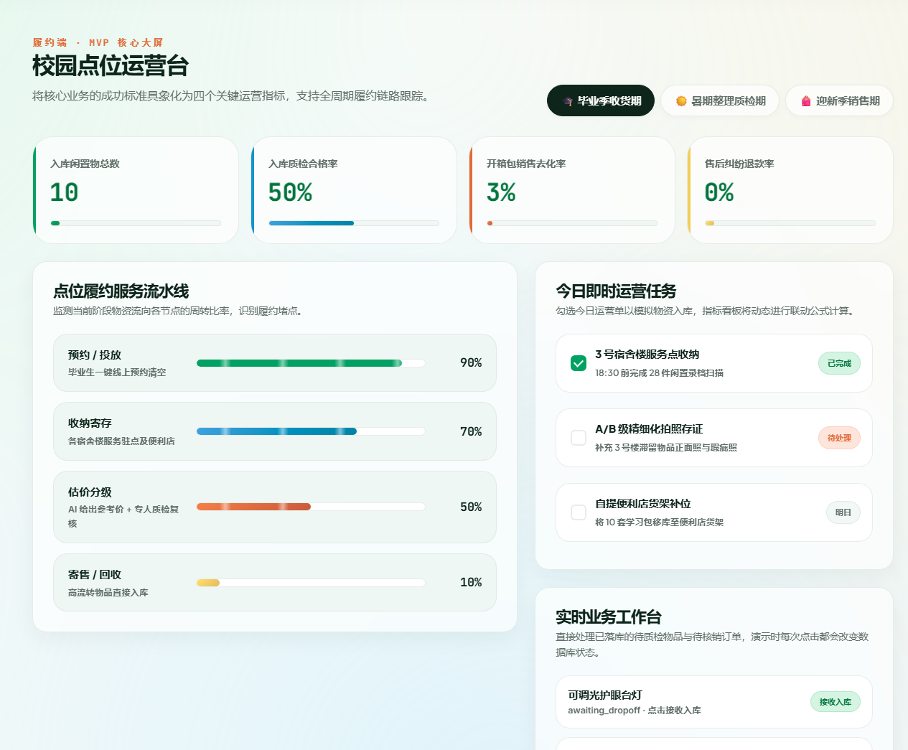

# 拾光盒子 CampusLoop

校园闲置流转与迎新物资服务 MVP。

**技术栈**：HTML / CSS / JavaScript、Flask、SQLite。

## 问题与实现

把毕业季闲置回收、新生组合包预约和点位运营串成一个可操作的流程原型。Flask 同时提供页面与 API，SQLite 保存物品、组合包、订单与任务状态；登记和预约会改变本地演示数据。

估价入口按基准价格与品相系数计算，不能作为经过训练和评测的 AI 定价模型成果。部分运营展示使用初始库存基线或预设值，图中指标不代表真实经营实验。

## 界面与成果

[演示导览](../docs/demo-guide.md) · [本地运行说明](../docs/deployment/campusloop.md)

闲置登记与品相选择。估价和时效属于 MVP 示例，不代表已验证的 AI 模型效果或实际服务承诺。

组合包浏览与预约清单，价格、库存均为演示用途。

点位流程与模拟指标，不代表真实营收、转化率或运营规模。

## 项目目标

围绕毕业季闲置托管、校园物资中转和新生开箱包，探索校园循环服务的业务流程。

## 已有原型范围

- 物品登记、状态流转与事件记录。
- 组合包与订单流程。
- 校园点位运营工作台。
- 业务与财务预测展示。

## 技术与边界

使用 HTML / CSS / JavaScript、Flask 和本地数据库构建原型。预测模型与演示数据不代表真实营收、用户规模或正式运营成果。公开仓库不包含订单、联系方式、领取凭证或数据库。

## 当前状态

最小可行原型。对外展示以业务流程和产品思路为主，不提供实际交易服务。

## 维护记录

- 2026-11-07：整理公开项目说明，区分原型预测与实际经营结果。

[项目状态与验证范围](../docs/project-status.md) · [返回作品集](../README.md)
