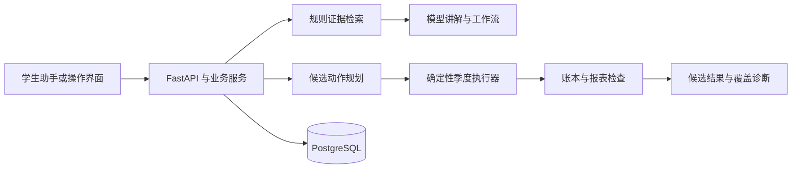
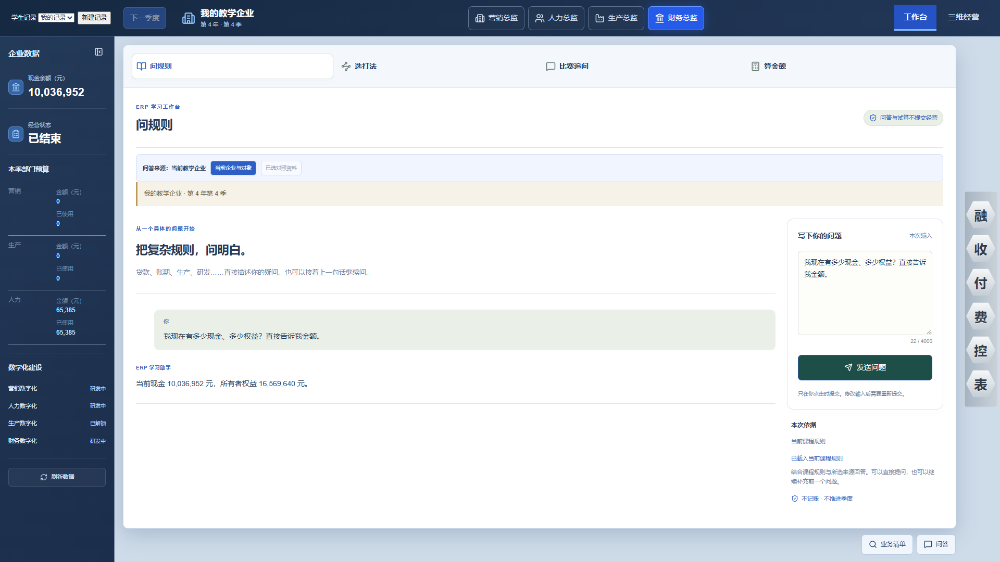
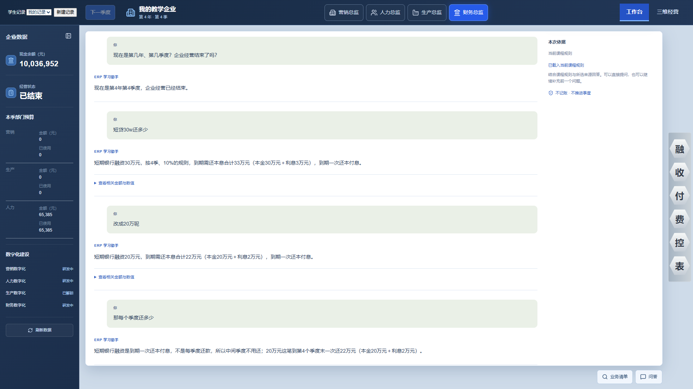

# ERP Agent

面向企业经营模拟课程的决策辅助系统。

**技术栈**：Python 3.12 / FastAPI、Pydantic、SQLAlchemy / PostgreSQL、Qdrant、LangGraph。

[看学生助手](#界面与成果) · [分工程运行说明](../docs/deployment/erp-agent.md) · [核验范围](../docs/verification.md)

## 问题与实现

经营模拟同时涉及现金、贷款、材料、生产、交付与报表。模型能解释规则，但生成一个方案并不能证明方案可执行；局部可行也不能证明整局最优。

| 具体问题 | 实现方式 | 可检查的产物 |
| --- | --- | --- |
| 问答可能混用规则与经营计算 | 规则检索提供依据，确定性执行器负责状态转移，服务与工作流负责组织调用 | [学生助手](../assets/erp-agent/teaching-workbench.png)区分问答与经营动作 |
| 候选方案缺少可执行性证明 | 将动作序列交给季度执行器回放，再检查账本、现金、报表与终局条件 | 主工程具有回放与失败诊断实现；原始路线和课堂记录保持私有 |
| 有界搜索被误写成最高分 | 记录预算、未覆盖域和失败诊断，将候选得分与最优性证明分开 | 结果表达保留候选与覆盖范围，不发布未经证明的最优结论 |
| 连续规则追问丢失参数 | 学生助手保留上下文并区分解释与试算 | [连续追问](../assets/erp-agent/rule-followup.png)展示金额调整与还款方式解释 |

## 技术结构与取舍

- **一种业务计算来源**：候选动作进入同一执行器，检索、模型、API 与界面不另建一套现金和计分公式。
- **证据与状态分层**：Qdrant 用于规则证据检索，PostgreSQL 用于状态持久化，LangGraph 组织工作流。
- **回放与搜索分开评价**：回放验证某条路线；搜索覆盖说明探索了哪些选择，二者共同决定能做多强的结果声明。
- **主工程与学生助手分别维护**：公开图片来自独立学生助手历史演示，不能用来证明主工程当前搜索能力或完整经营链通过。

## 界面与成果

[演示导览](../docs/demo-guide.md) · [主工程与学生助手运行说明](../docs/deployment/erp-agent.md)

学生助手独立界面的历史演示，展示模拟企业状态与只读问答。资金为模拟数据，不代表真实资产或官方成绩。

贷款规则的连续追问示例。问答与试算不自动推进经营状态；学生助手画面不等于主工程当前规划能力已完整验收。

这两张图片展示只读查询与规则追问，不是自动规划演示或官方比赛成绩。主工程的技术成果以确定性状态执行、候选回放和诊断结构说明，未公开原始运行日志。

## 当前边界

持续开发。本轮只读核对依赖、模块边界、回放入口及现行工程状态，没有启动新搜索、操作教学平台或重跑全仓测试。候选方案得分不等于官方成绩或全局最优解；搜索覆盖、完整经营链和整体验收仍需分项验证。

## 维护记录

- 2026-11-07：建立公开项目说明，明确候选结果与最优性证明的区别。
- 2026-11-08：补充规则、检索、规划与回放的职责划分，以及主工程和学生助手的成果对应关系。

[项目状态与验证范围](../docs/project-status.md) · [返回作品集](../README.md)
