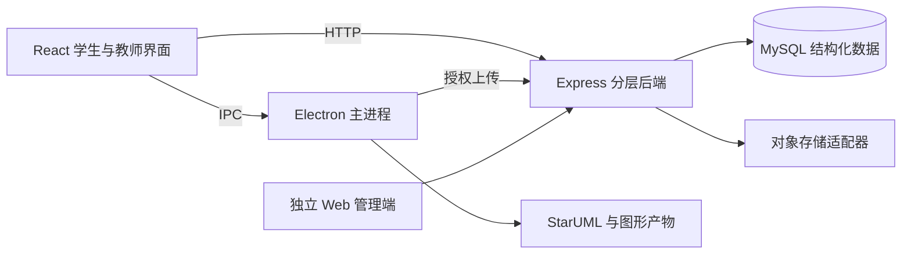

# ISAD

面向信息系统分析与设计教学的工具项目。

**技术栈**：Electron / React / Vite、Node.js / Express、MySQL、Electron IPC、StarUML。

[看界面与顺序图](#界面与成果) · [运行与构建](../docs/deployment/isad.md) · [核验范围](../docs/verification.md)

## 问题与实现

课程分析、对象建模和图形产物需要保持一致。草稿修改后，旧图或旧质量报告容易被误用；桌面绘图工具、服务器数据与角色审核也需要清晰的职责划分。

| 具体问题 | 实现方式 | 对应产物或行为 |
| --- | --- | --- |
| 分析内容难以形成连续建模流程 | 用结构化需求、用例、BCE 对象和字段定义组织分析，再生成建模产物 | [BCE 分析](../assets/isad/bce-analysis.png)、[数据库设计](../assets/isad/database-design.png)与[实际顺序图](../assets/isad/design-sequence.png) |
| 草稿更新后旧结果仍可能被误用 | 用分析指纹区分 working data 与 revision；提交前检查版本、质量报告和正式图包准备度 | 当前提交服务会阻断过期分析快照或未准备好的图包；本轮核对实现，未重跑完整提交流程 |
| 本地工具调用与界面耦合 | React 经 IPC 请求 Electron 主进程，主进程编排 StarUML 与文件处理；预览请求过期时丢弃结果，失败时保留最近成功结果 | [建模控制台](../assets/isad/modeling-console.png)展示成果状态、预览和下载入口 |

## 技术结构与取舍

- **业务数据与文件分开**：MySQL 管理结构化明细、版本和文件元信息，图包走对象存储适配器。当前本地开发存储不等于已经完成云迁移。
- **工具能力留在桌面主进程**：renderer 不直接执行本机进程或访问文件系统；StarUML 属于 Electron 内部集成。
- **预览与正式交付分开**：草稿预览便于修改，正式提交要求版本与质量状态匹配，生成图片本身不能替代语义检查。
- **服务端控制角色与提交条件**：按路由、控制器、服务、仓储与校验分层；学生、教师和管理员界面具有不同职责。

## 界面与成果

[演示导览](../docs/demo-guide.md) · [运行与构建说明](../docs/deployment/isad.md)

按需求、行为和对象建模组织成果。隔离 QA 使用“作业提交与取消”示例和验收角色，没有真实学生资料。

将用例拆为边界、控制与实体职责。截图仍显示分析进度和警告，不代表全部语义验收完成。

结构化编辑英文列名、SQL 类型、主键与可空规则；图中只有演示字段定义，没有真实数据行。

实际生成的主线交互产物，用于展示页面、控制器与实体协作，不宣称覆盖全部异常分支。

公开成果包含三张界面和一张实际生成的顺序图。示例覆盖主线交互；截图中的进度与警告仍需按各自范围解释。

## 当前状态

持续维护。本轮核对当前 Electron 工程的包脚本、后端提交准备度、预览编排及 IPC 边界，没有沿用历史 Next.js / Tauri / 独立 Bridge 架构。未重跑 MySQL 联调、StarUML 和安装包回归；没有公开学生作品、教学账号或安装包。

## 维护记录

- 2026-11-07：建立独立公开介绍。
- 2026-11-07：核对桌面工程后，更正技术结构说明，删除将历史技术方案标为当前重构方向的表述。
- 2026-11-08：补充版本一致性、提交门禁、IPC 和 StarUML 编排的技术案例与架构图。

[项目状态与验证范围](../docs/project-status.md) · [返回作品集](../README.md)
