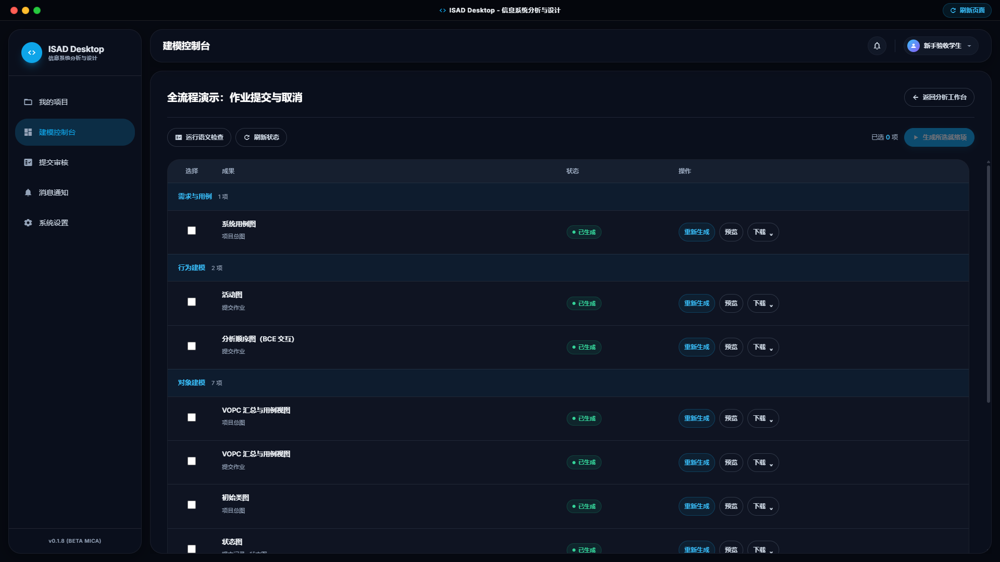
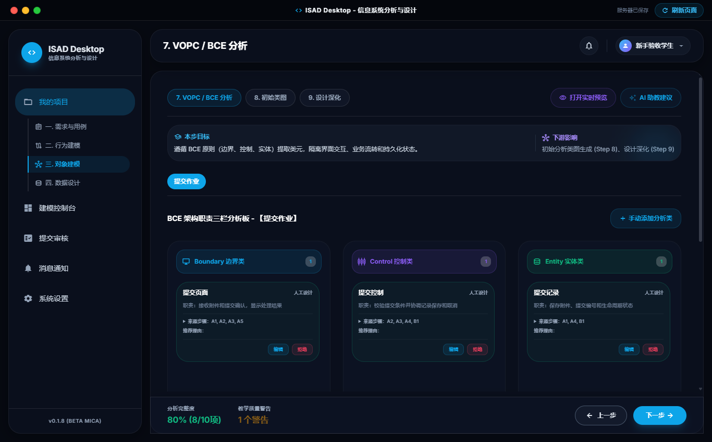
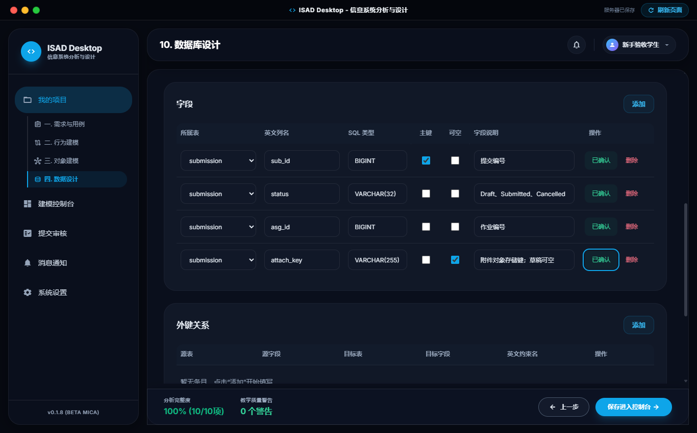
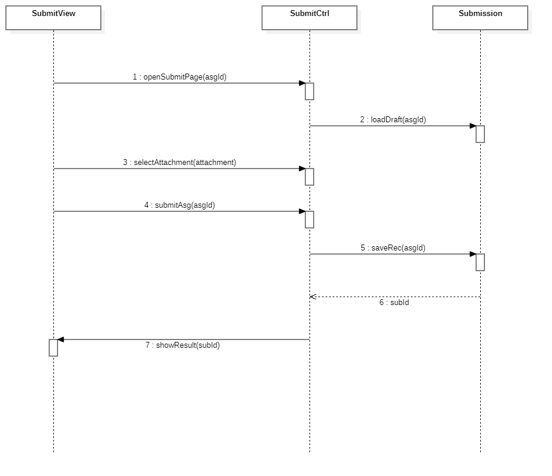

# ISAD

面向信息系统分析与设计教学的工具项目。

## 界面与成果

[演示导览](../docs/demo-guide.md) · [运行与构建说明](../docs/deployment/isad.md)

按需求、行为和对象建模组织成果。隔离 QA 使用“作业提交与取消”示例和验收角色，没有真实学生资料。

将用例拆为边界、控制与实体职责。截图仍显示分析进度和警告，不代表全部语义验收完成。

结构化编辑英文列名、SQL 类型、主键与可空规则；图中只有演示字段定义，没有真实数据行。

实际生成的主线交互产物，用于展示页面、控制器与实体协作，不宣称覆盖全部异常分支。

## 项目目标

连接课程分析、建模、生成与查看流程，通过桌面客户端、后端服务和独立管理页面组织教学项目。

## 已核实的技术结构

- **桌面客户端**：Electron、React 和 Vite。
- **后端服务**：Node.js / Express，按路由、控制器、服务和数据访问等职责分层。
- **数据与管理**：MySQL 及独立的 Web 管理端。
- **建模集成**：StarUML 调用与产物处理组织在 Electron 客户端内部，不依赖单独启动的 Bridge 进程。

本页依据已核查的桌面工程描述技术结构，不将历史方案、旧分支或旧测试结果标作当前版本的成果。

## 维护重点

- 教学项目的分析、建模与产物处理流程。
- 角色权限、结构化数据与客户端接口边界。
- 本地工具集成、错误恢复及回归验证。

## 当前状态

项目持续维护。公开资料不包含学生作品、教学账号、模型配置或源码。尚未在本公开仓库发布可下载的软件版本，也不在此宣称最新完整测试已经通过。

## 维护记录

- 2026-11-07：建立独立公开介绍。
- 2026-11-07：核对桌面工程后，更正技术结构说明，删除将历史技术方案标为当前重构方向的表述。

[项目状态与验证范围](../docs/project-status.md) · [返回作品集](../README.md)
