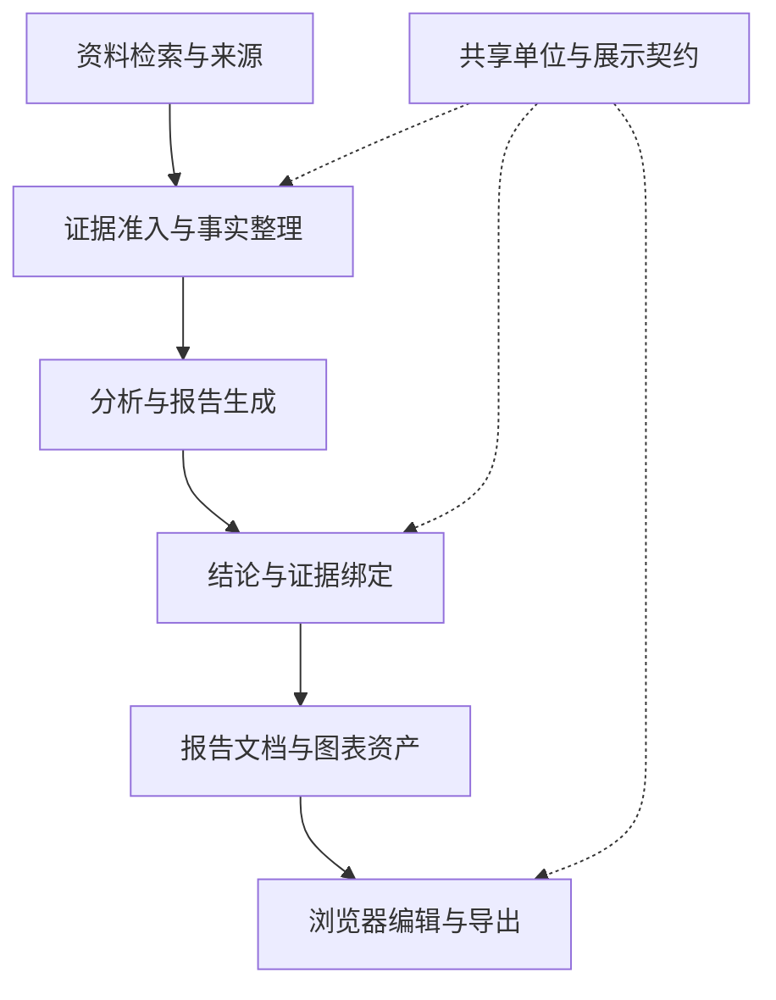
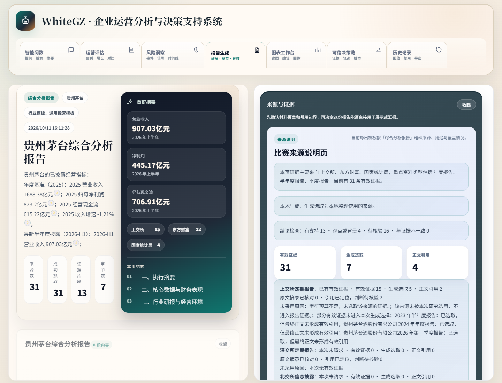
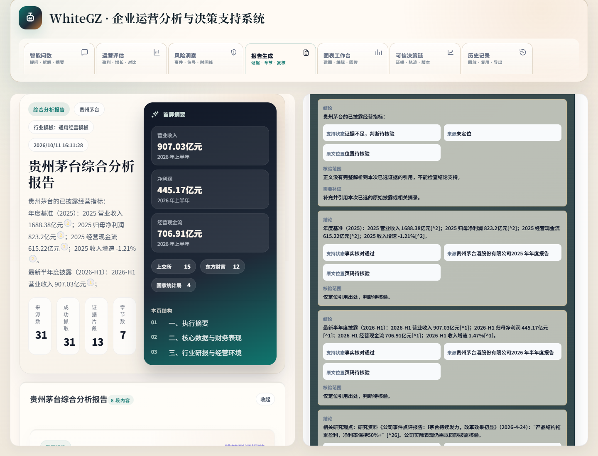
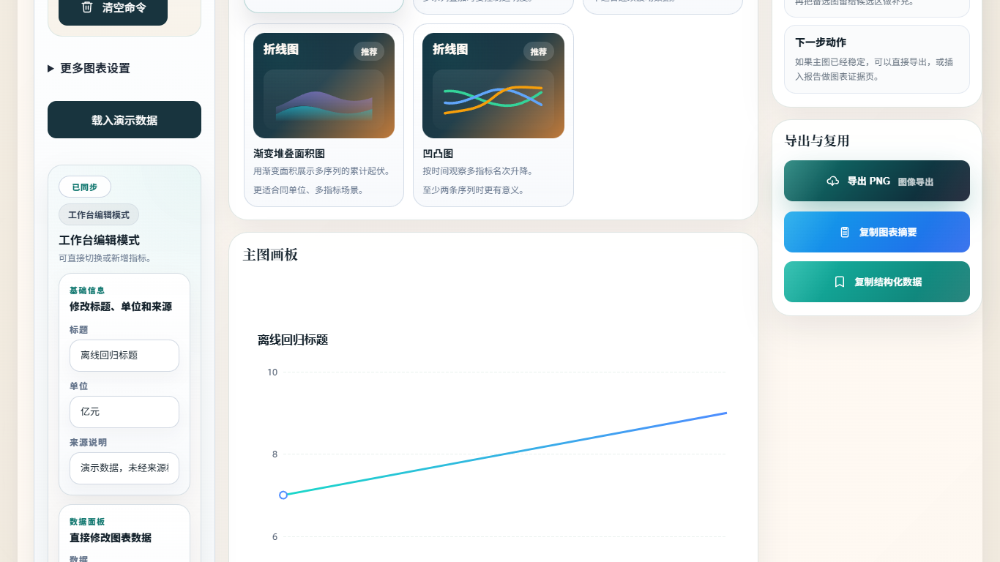

# WhiteGZ

企业研究、证据追踪与报告工作台。

**技术栈**：Node.js / Express、模块化 JavaScript 前端、跨层共享契约、可选 SQLite 缓存与持久化。

[看界面](#界面与成果) · [运行与发布检查](../docs/deployment/whitegz.md) · [核验范围](../docs/verification.md)

## 问题与实现

企业研究需要汇总不同来源和期间的资料。仅生成一段分析文字，难以判断数值是否同口径、引用是否支持结论，也难以持续修订报告。

| 具体问题 | 实现方式 | 可查看的结果 |
| --- | --- | --- |
| 指标单位、期间与证据来源容易混淆 | 事实层与证据准入分开处理，结论绑定时对齐指标、数值和单位；缺页码或依据不足保留提示 | [证据检查](../assets/whitegz/evidence-review.png)分别显示支持状态、来源与原文定位状态 |
| 有引用不等于结论得到支持 | 分开表达来源覆盖、生成选取、正文引用和结论支持，保留待核验状态 | [报告工作台](../assets/whitegz/report-workbench.png)可追踪材料进入报告的环节 |
| 报告和图表后续难以编辑复用 | 报告文档、章节、来源引用和图表槽位组织为结构化资产；前后端复用单位与图表规则 | [图表工作台](../assets/whitegz/chart-lab.png)可编辑标题、单位和数据，提供导出入口 |

## 技术结构与取舍

- **保留原版产品入口**：Express 提供 API 与静态前端，按领域拆分路由、服务和前端模块，在现有产品上维护证据与报告能力。
- **统一数据口径**：纯 JavaScript 共享契约供服务端、浏览器和测试复用，减少单位、图表和证据展示各写一套规则的问题。
- **把不确定性留在界面**：来源匹配、事实核对和判断支持是不同状态；不能因页面有引用就直接显示为结论可靠。
- **运行数据单独保存**：缓存、历史、账号和模型配置属于私有运行环境，不随展示资料发布。

## 界面与成果

[演示导览](../docs/demo-guide.md) · [运行与发布检查](../docs/deployment/whitegz.md)

原版报告工作台：经营指标、报告章节与来源覆盖。历史公开来源样本的本地回放，仅用于功能展示；数字未在本次发布中重新核验，不构成投资建议。

结论支持检查区分已有依据与待核验状态，不把有引用等同于结论已经验证。

合成演示数据下的标题、单位、数据编辑与导出入口，不是真实企业分析结论。

当前可公开核实的产物是上述三张界面及对应的数据处理结构，不包含效率提升、分析准确率或业务收入等未验证指标。

## 当前状态

持续维护。本轮只读核对了当前主工程的架构、证据绑定、报告资产和包脚本；没有修改产品代码或重跑模型、导出和全量回归。公开截图为历史演示，不能代替当前版本验收。

## 维护记录

- 2026-11-07：建立独立公开介绍，将产品介绍与私有源码分开管理。
- 2026-11-08：补充证据处理、共享契约与报告资产的实现说明和架构图，对照当前主工程核对表述。

[项目状态与验证范围](../docs/project-status.md) · [返回作品集](../README.md)
